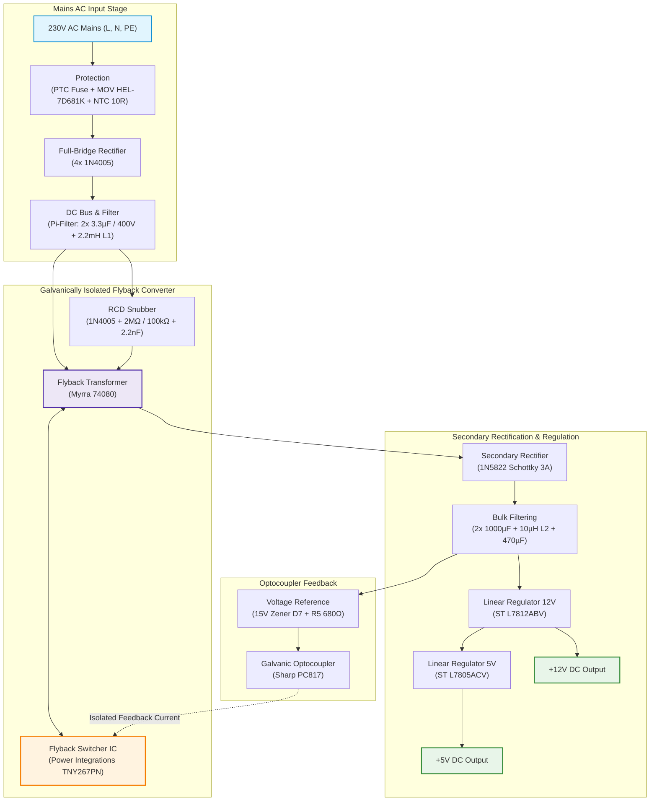
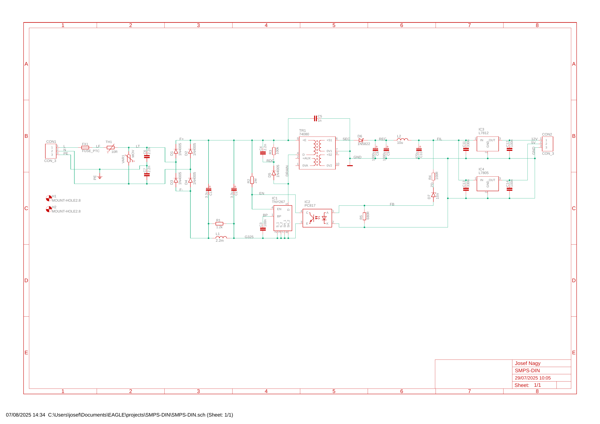

# DIN-Rail Switched-Mode Power Supply (`din-smps`)

> Highly reliable, galvanically isolated offline flyback power supply designed for standard DIN-rail modular enclosures, powering home automation controllers and bus peripherals.

**Project Status:** `Completed / Production Ready` | **EDA Tool:** `Autodesk Eagle 9.x` | **Category:** `Power Electronics / Hardware`

---

## 1. Overview and Purpose

The `din-smps` repository provides an offline AC/DC switched-mode power supply (SMPS) engineered specifically to fit standard 35 mm DIN-rail modular enclosures (such as the **Kradex Z106J** series). The power supply converts wide-range AC mains (85–265 V AC, 50/60 Hz) into stable, clean, galvanically isolated DC voltages required by modular home automation equipment, relay drivers, microcontrollers, and communication transceivers.

### Key Features
- **Galvanic Isolation:** Primary-to-secondary isolation exceeding 3 kV via an optocoupler feedback loop and specialized flyback transformer.
- **High Efficiency & Low Standby:** Powered by the **Power Integrations TNY267PN** TinySwitch-II offline switcher with EcoSmart® technology, providing auto-restart, cycle skipping, and thermal shutdown.
- **Robust Mains Protection:** Multistage input stage incorporating an overcurrent PTC fuse, Metal Oxide Varistor (MOV) surge arrestor, and NTC inrush current limiter.
- **Dual Regulated Output Rails:** Delivers regulated **+12 V DC** (for relay coils, RS-485 bus line, and actuators) and **+5 V DC** (for digital logic and microcontrollers).
- **CAD & Mechanical Enclosure Ready:** Includes board layout, schematic, CAM drill legends, and exact mechanical DXF outlines aligned with the Kradex Z106J modular enclosure.

---

## 2. Technical Specifications

| Parameter | Specification (`SMPS-DIN`) |
| :--- | :--- |
| **Input Voltage Range** | 85 – 265 V AC, 50/60 Hz |
| **Primary Topology** | Discontinuous Flyback Converter |
| **Primary Controller IC** | Power Integrations TNY267PN |
| **Transformer** | Myrra 74080 (designed for TinySwitch-II) |
| **Output Voltages** | **+12 V DC** (Regulated) & **+5 V DC** (Regulated) |
| **Linear Post-Regulators** | STMicroelectronics L7812ABV & L7805ACV |
| **Output Rectifier** | 1N5822 (3 A / 40 V Schottky Barrier Rectifier) |
| **Feedback Loop** | Sharp PC817 optocoupler + 15V Zener diode reference |
| **Input Protection** | PTC Resettable Fuse, MOV 680V (HEL-7D681K), NTC 10 Ω |
| **EMI / Safety Filtering** | 2.2 mH filter choke + Y-class ceramic capacitors |
| **Target Enclosure** | Kradex Z106J PS DIN-Rail Modular Box |
| **PCB Form Factor** | Double-sided 1.6 mm FR4, custom enclosure outline |

---

## 3. Architecture & Functional Blocks

The converter follows an offline flyback architecture with secondary linear post-regulation for ultra-low noise:



### Detailed Functional Breakdown
1. **Input Protection & Rectification:**
   - Overcurrent protection via PTC resettable fuse (`FX1`).
   - AC surge absorption via Metal Oxide Varistor (`VAR1`, HEL-7D681K / 420V AC rating).
   - Inrush current limitation at power-up through a 10 Ω NTC thermistor (`TH1`).
   - Full-wave rectification using 1N4005 diodes (`D1`–`D4`) followed by a pi-filter (`C1`, `C2` 3.3 µF / 400V electrolytics and `L1` 2.2 mH choke) to attenuate switching frequencies back into the grid.
2. **Flyback Inversion (TNY267PN):**
   - Incorporates a 700 V power MOSFET, oscillator, high-voltage switched current source, current limit comparator, and thermal shutdown circuitry on a single monolithic IC.
   - Operates in discontinuous conduction mode (DCM) utilizing ON/OFF state control to regulate output voltage with high light-load efficiency.
   - Primary voltage spikes resulting from transformer leakage inductance are clamped by an RCD snubber network (`D5`, `R2`, `R3`, `C4`).
3. **Galvanic Isolation & Feedback Loop:**
   - Output voltage sensing is carried out on the intermediate ~16 V DC rail using a 15 V Zener diode (`D7`) connected in series with the LED emitter of a **Sharp PC817** optocoupler (`IC2`).
   - When the secondary voltage exceeds the Zener threshold (~16.2 V), current conducts through the optocoupler, pulling down the `EN/UV` (Enable/Under-Voltage) pin of the TNY267PN to skip switching cycles.
4. **Post-Regulation Stage:**
   - **+12 V DC Rail:** Regulated by STMicroelectronics `L7812ABV` to supply solid, hum-free DC power for DIN-rail relays, bus transceivers, and external sensors.
   - **+5 V DC Rail:** Cascaded via STMicroelectronics `L7805ACV` for logic circuits, microcontrollers, and Ethernet/CAN controller boards.

---

## 4. Hardware Schematic & Visuals

Below is the full schematic diagram of the dual-output SMPS-DIN converter:



📄 [Open original full-resolution schematic (PDF)](SMPS-DIN.pdf)

---

## 5. Repository Structure

```text
.
├── SMPS-DIN.sch                   # Primary schematic (Autodesk Eagle)
├── SMPS-DIN.brd                   # Primary 2-layer PCB layout (Autodesk Eagle)
├── SMPS-DIN.dxf                   # Mechanical outline and mounting drawing (DXF)
├── SMPS-DIN.pdf                   # Schematic and layout printout
├── DRILEGEND.CFG                  # Eagle drill legend configuration
├── docs/
│   ├── images/                    # Rendered 180 DPI hardware visuals
│   │   └── smps_din_schematic.png # Standard model schematic preview
│   ├── calculations/
│   │   ├── Součástky.xlsx         # Component selection & parameter calculations
│   │   ├── Součástky (version 1).xlsb.xlsx # Early design calculation sheet
│   │   └── order_32668509.csv     # TME procurement order list and parts BOM
│   ├── datasheets/                # Full PDF datasheets for all active & passive parts
│   │   ├── tny263-268g_p.pdf      # Power Integrations TinySwitch-II datasheet
│   │   ├── 74080.pdf              # Myrra 74080 flyback transformer datasheet
│   │   ├── PC817X3NSZ1B.pdf       # Sharp PC817 optocoupler datasheet
│   │   ├── 1N5822-ST.pdf          # ST 1N5822 Schottky diode datasheet
│   │   ├── L78.pdf                # ST L7812 / L7805 linear regulator datasheet
│   │   └── ...                    # Additional component datasheets
│   └── README.md                  # Documentation index
└── README.md                      # Main repository documentation
```

---

## 6. Bill of Materials & Sourcing

The repository includes complete component calculation and procurement files located in [docs/calculations/](file:///c:/Users/josef/Documents/EAGLE/projects/SMPS-DIN/docs/calculations).

### Core Components Summary

| Designator | Component / Part Number | Manufacturer | Package / Footprint | Description |
| :--- | :--- | :--- | :--- | :--- |
| `IC1` | **TNY267PN** | Power Integrations | DIP-8B | TinySwitch-II offline flyback switcher IC |
| `IC2` | **PC817X4NSZ1B** | Sharp | DIP-4 | Galvanic isolation optocoupler |
| `IC3` | **L7812ABV** | STMicroelectronics | TO-220 | Linear positive voltage regulator (+12 V, 1 A) |
| `IC4` | **L7805ACV** | STMicroelectronics | TO-220 | Linear positive voltage regulator (+5 V, 1 A) *(Standard only)* |
| `TR1` | **74080** | Myrra | PCB Mount | Flyback transformer (optimized for TNY series) |
| `D1–D4, D5` | **1N4005** | Diotec | DO-41 (Vertical) | 600 V / 1 A silicon rectifiers |
| `D6` | **1N5822** | STMicroelectronics | DO-201AD | 40 V / 3 A Schottky barrier rectifier diode |
| `D7` | **BZX55C15** | Vishay / CDIL | DO-35 | 15 V / 0.5 W Zener voltage reference diode |
| `VAR1` | **HEL-7D681K** | SR Passives | Radial Disk 7 mm | Metal Oxide Varistor (420 V AC continuous) |
| `TH1` | **NTCS-10-10-2** | SR Passives | Radial Disk | 10 Ω NTC inrush current limiter *(Standard only)* |
| `FX1` | **FX100-30** | ECE | Radial | Resettable PTC fuse (with PTF/77 holder) |
| `L1` | **COIL1010-2.2** | Ferrocore | Radial Choke | 2.2 mH power inductor (input Pi-filter) |
| `L2` | **COIL0608-0.01** | Ferrocore | Radial Choke | 10 µH power inductor (secondary filter) |
| `C1, C2` | **ECA2GM3R3B** | Panasonic | Radial Ø10 mm | 3.3 µF / 400 V DC electrolytic capacitor |
| `C8, C9` | **EWH1EK102G20OT** | Aishi | Radial Ø10 mm | 1000 µF / 25 V low-ESR electrolytic capacitor |
| `C10` | **PF1V471MNN1020** | Elite | Radial Ø10 mm | 470 µF / 35 V low-ESR electrolytic capacitor |
| `CON1` | **XY301V-3P+ (5.00)** | Xinya | 5.00 mm Pitch | 3-position screw terminal block (AC Mains) |
| `CON2` | **XY301V-3P+ (5.00)** | Xinya | 5.00 mm Pitch | 3-position screw terminal block (DC Outputs) |
| `ENCL` | **Z106J PS** | Kradex | Modular Box | DIN-rail enclosure (see `SMPS-DIN.dxf`) |

---

## 7. Manufacturing & EDA Guidelines

### Opening and Editing in Autodesk Eagle
1. Open Autodesk Eagle (version 8.x, 9.x, or Autodesk Fusion 360 Electronics).
2. Open project:
   - For standard version: open `SMPS-DIN.sch` / `SMPS-DIN.brd`.
   - For compact version: open `variants/smps-din-lite/SMPS-DIN-LITE.sch` / `SMPS-DIN-LITE.brd`.
3. To generate Gerber / drill files for PCB production, load standard 2-layer CAM job and apply `DRILEGEND.CFG`.

### Safety and High-Voltage Notice
> [!WARNING]
> This circuit is directly connected to hazardous 230 V AC mains voltage! High voltages up to ~400 V DC are present across `C1`, `C2`, and the primary side of `TR1` during operation and for some time after disconnection.
> - Ensure appropriate creepage and clearance distances (> 6.0 mm) between primary and secondary copper traces.
> - Always bench-test using an isolating transformer and current-limited mains supply.
> - Install within a certified insulating DIN enclosure (e.g. Kradex Z106J) before connecting to mains.

---

## 8. Cross-Project Relationships & Ecosystem

This project is an integral building block of the **Smart Home DIN-Rail Ecosystem**:
- **[din-smps-lite](https://github.com/nagyjose/din-smps-lite):** Space-optimized single-rail (+12 V) DIN power supply variant for auxiliary racks.
- **[din-control-module](https://github.com/nagyjose/din-control-module):** Main DIN-rail central automation unit, powered by the +12V / +5V rails from this supply.
- **[din-relay-module](https://github.com/nagyjose/din-relay-module):** DIN-rail 8-channel power relay actuator module, drawing coil power from the +12V rail.
- **[domovni-rozvadec-dokumentace](https://github.com/nagyjose/domovni-rozvadec-dokumentace):** Cabinet wiring diagrams and schematics showing installation of this SMPS alongside the Wattrouter controller.

---

## 9. License

This hardware project is open source and licensed under the [MIT License](LICENSE) (or CERN Open Hardware Licence v2 - Permissive).
